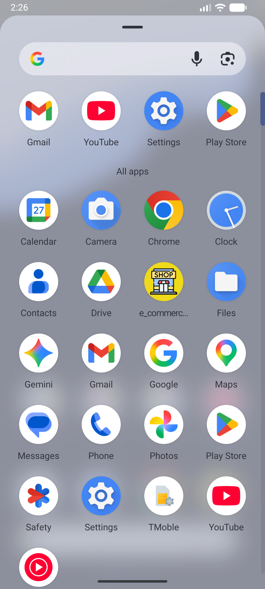
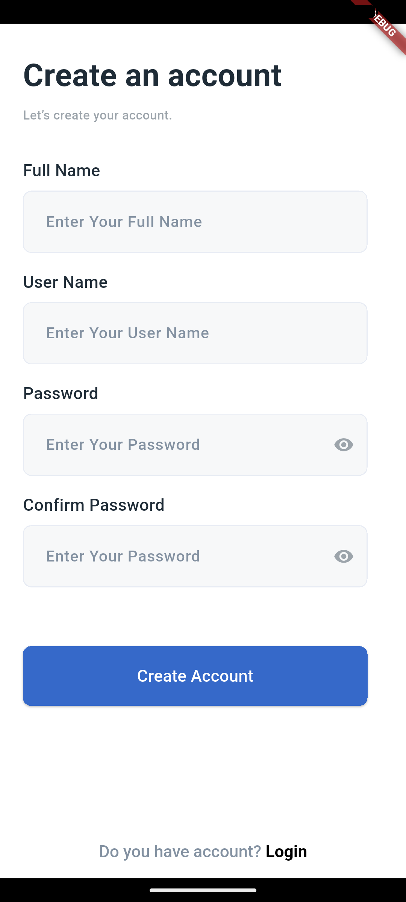
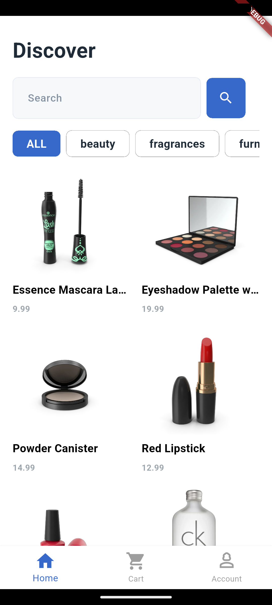
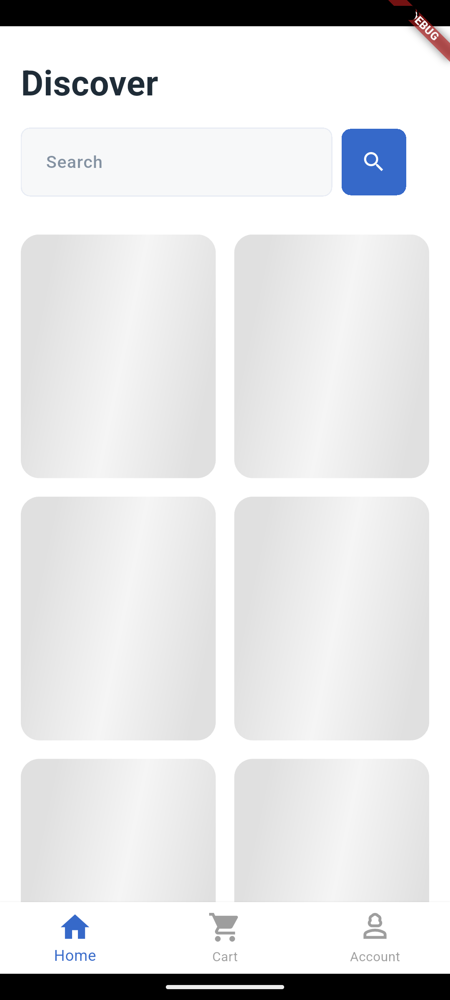
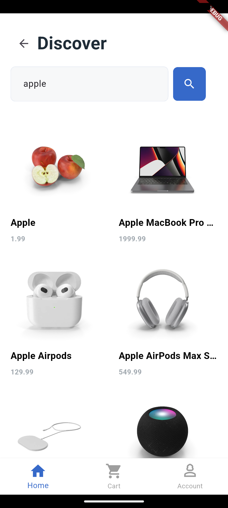
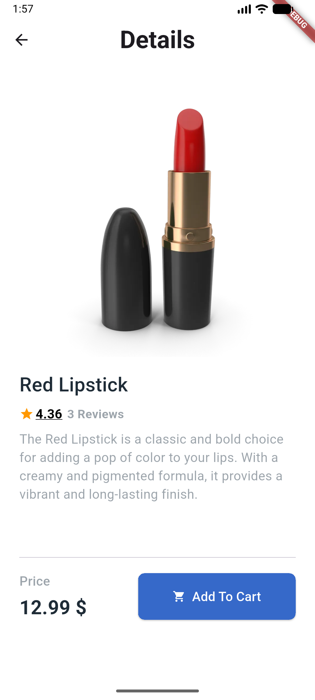
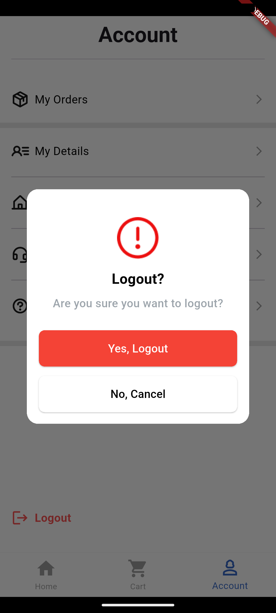
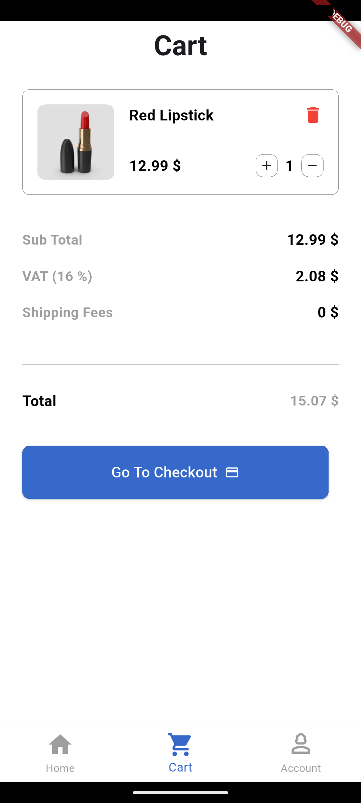

# 🛍️ E-Commerce App

A fully functional **E-Commerce mobile application** built with **Flutter**, featuring a clean UI and smooth user experience using the **Cubit** state management pattern.

---

## 📱 Screenshots

         

---

## ✨ Features

- 🔐 **Authentication** — User Registration & Login with form validation
- 🏠 **Home Screen** — Browse products fetched from a live REST API
- 📦 **Product Listing** — Display products with images, names, and prices
- 🔍 **Product Details** — Detailed view for each product
- 🛒 **Shopping Cart** — Add/remove items and view total price
- 👤 **User Profile** — View and manage account info
- 🎨 **Smooth Animations** — Staggered animations & Lottie files
- ⚡ **Shimmer Loading** — Beautiful loading placeholders
- 🔒 **Secure Storage** — Auth tokens stored securely
- 🧭 **Clean Navigation** — Powered by GoRouter

---

## 🛠️ Tech Stack

| Technology | Usage |
|---|---|
| **Flutter** | UI Framework |
| **Dart** | Programming Language |
| **Cubit (flutter_bloc)** | State Management |
| **Dio** | HTTP Client & API Calls |
| **GoRouter** | Navigation & Routing |
| **GetIt** | Dependency Injection |
| **Dartz** | Functional Programming (Either) |
| **flutter_secure_storage** | Secure Token Storage |
| **cached_network_image** | Image Caching |
| **Shimmer** | Loading Skeleton UI |
| **Lottie** | Animations |
| **flutter_screenutil** | Responsive UI |

---

## 📂 Project Structure

```
lib/
├── core/
│   ├── api/          # Dio client & endpoints
│   ├── di/           # GetIt dependency injection
│   └── utils/        # Helper functions & constants
├── features/
│   ├── auth/         # Login & Register screens + Cubit
│   ├── home/         # Home screen + Cubit
│   ├── products/     # Product listing & details + Cubit
│   └── cart/         # Cart screen + Cubit
└── main.dart
```

---

## 🚀 Getting Started

### Prerequisites
- Flutter SDK >= 3.0.0
- Dart >= 3.0.0

### Installation

```bash
# 1. Clone the repository
git clone https://github.com/A7-samie/e_commerce_app.git

# 2. Navigate to project directory
cd e_commerce_app

# 3. Install dependencies
flutter pub get

# 4. Run the app
flutter run
```

---

## 📦 Dependencies

```yaml
dependencies:
  flutter_screenutil: ^5.9.3
  go_router: ^14.6.2
  pretty_dio_logger: ^1.4.0
  flutter_bloc: ^9.0.0
  dio: ^5.7.0
  cached_network_image: ^4.0.6
  lottie: ^3.8.2
  dartz: ^0.10.1
  animated_snack_bar: ^0.4.0
  get_it: ^9.3.0
  flutter_secure_storage: ^11.2.0
  flutter_staggered_animations: ^1.1.1
  go_transitions: ^0.8.4
  shimmer: ^4.0.0
  material_ui: ^1.11.1
  shared_preferences: ^2.5.6
```

---

## 🔗 API

This app fetches product data from a public REST API. Products are displayed dynamically with real-time data loading and error handling using **Dio** with **pretty_dio_logger** for debugging.

---

## 👨‍💻 Author

**A7-samie**  
GitHub: [@A7-samie](https://github.com/A7-samie)

---

## 📄 License

This project is open source and available under the [MIT License](LICENSE).